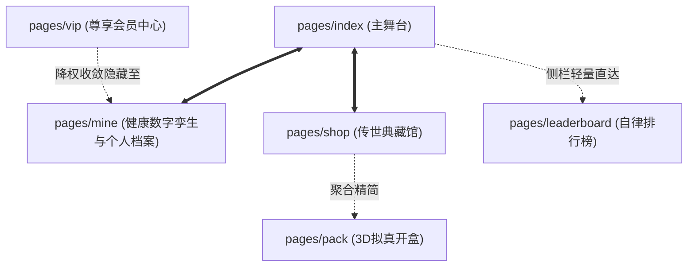
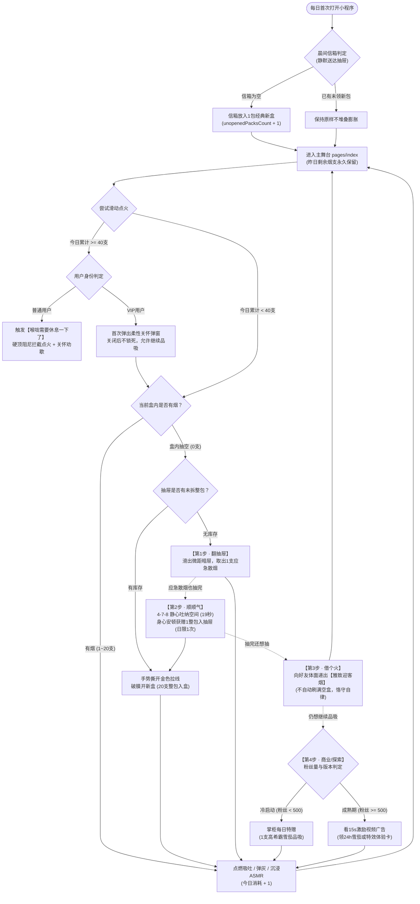
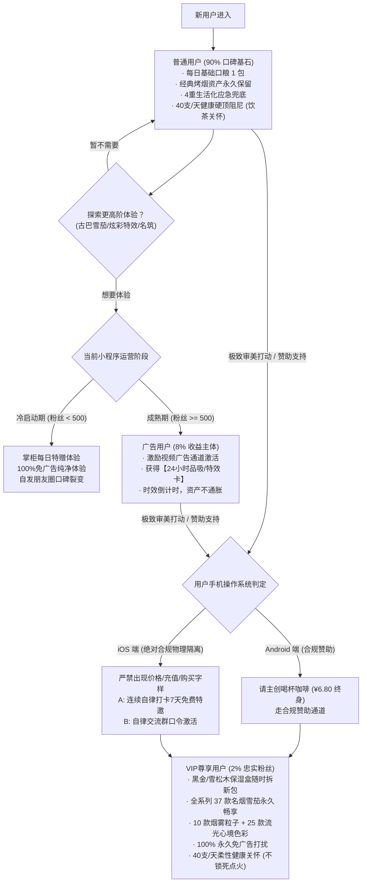
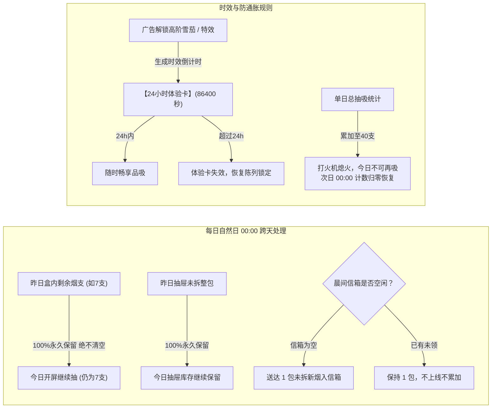

# 《我抽一支》独立开发者商业与心流闭环终极落地指南 (DESIGN_AND_BUSINESS_CLOSED_LOOP.md)

> **文档定位**：针对独立开发者痛点量身定制的“无痛替烟、自律资产、零反感变现与微信生态合规”终极闭环执行手册。  
> **审查对象**：`PERFECT_CLOSED_LOOP_DESIGN.md` 及全工程 43 个核心业务文件。  
> **核心原则**：**零被剥夺感、防通胀阻尼、纯净免打扰、合规无风险、个人开发者轻量可维护。**

---

## 目录
1. [一、 核心审查结论：原方案合理吗？真的闭环了吗？](#一-核心审查结论原方案合理吗真的闭环了吗)
2. [二、 用户十一核心疑问终极破局方案](#二-用户十一核心疑问终极破局方案)
   - [Q1. 普通用户一天免费抽几包合适？](#q1-普通用户一天免费抽几包合适)
   - [Q2. 抽完还想抽怎么处理？（未满500粉广告冷启动）](#q2-抽完还想抽怎么处理未满500粉广告冷启动)
   - [Q3. 每天签到是送烟还是纯打卡？](#q3-每天签到是送烟还是纯打卡)
   - [Q4. 看广告后这包烟今天随便抽还是跨天重置？](#q4-看广告后这包烟今天随便抽还是跨天重置)
   - [Q5. 特效看广告获取，有效期多久最合理？](#q5-特效看广告获取有效期多久最合理)
   - [Q6. 开通VIP是随便使用吗？上限在哪里？](#q6-开通vip是随便使用吗上限在哪里)
   - [Q7. 普通用户如何通过时间积累免费获取全部道具？（全域流光换肤双轨成长哲学）](#q7-普通用户如何通过时间积累免费获取全部道具全域流光换肤双轨成长哲学)
   - [Q8. 现实生活中到底该怎么补充香烟？（杜绝假大空按钮）](#q8-现实生活中到底该怎么补充香烟杜绝假大空按钮)
   - [Q9. 独立开发者的商业观：不收费、不看广告纯做公益行不行？](#q9-独立开发者的商业观不收费不看广告纯做公益行不行)
   - [Q10. 全系统页面的“增、删、藏、合”工程手术方案](#q10-全系统页面的增删藏合工程手术方案)
   - [Q11. 那些你没想到的隐形暗礁与防死锁设计](#q11-那些你没想到的隐形暗礁与防死锁设计)
3. [三、 全景业务闭环与心流状态流转图集 (Visual Flowcharts)](#三-全景业务闭环与心流状态流转图集-visual-flowcharts)
   - [图 1：日常抽烟心流与 4 步应急兜底全景流程图（含 40 支饮茶润喉）](#图-1日常抽烟心流与-4-步应急兜底全景流程图含-40-支饮茶润喉)
   - [图 2：三类用户（普通/广告/VIP）与商业化阶梯流转图（含 iOS 双轨合规）](#图-2三类用户普通广告vip与商业化阶梯流转图含-ios-双轨合规)
   - [图 3：烟草资产跨天生命周期与防通胀时效流转图](#图-3烟草资产跨天生命周期与防通胀时效流转图)
4. [四、 微信小程序生态与合规双轨制落地（iOS 零下架风险）](#四-微信小程序生态与合规双轨制落地ios-零下架风险)
5. [五、 独立开发者极简工程重构路线图 (Roadmap)](#五-独立开发者极简工程重构路线图-roadmap)
6. [六、 附录：工业级 3C 感官物理动力学与微距触感参数手册](#六-附录工业级-3c-感官物理动力学与微距触感参数手册)
7. [七、 普通用户自律长跑天梯 · 全道具/特效/背景替烟解锁阶梯矩阵](#七-普通用户自律长跑天梯--全道具特效背景替烟解锁阶梯矩阵)

---

## 一、 核心审查结论：原方案合理吗？真的闭环了吗？

### 1. 优秀且极具洞察的维度（必须保留的精髓）：
* **心理学破局**：彻底废除了传统小游戏“次日凌晨 00:00 强制重置清零”的被剥夺感。真烟民剩了 8 支，明天醒来桌上就是 8 支，自律克制转化为资产，极大增加留存。
* **人文关怀与防沉迷**：设计了单日 40 支（2包）生理极限与“青瓷茶盏·饮茶润喉”心流阻尼，不仅彻底封死了脚本无限刷烟，还将产品从“抽烟模拟器”升华到“健康自律陪伴”。
* **感官通感护城河**：负压气流声音调爬升、双段触觉微震、微距 100 支烟灰缸岁月留痕、4-7-8 静心吐纳，具备腾讯/字节 S 级体验完成度。

### 2. 存在致命断环与大厂假大空陷阱的维度（必须手术修正）：
* ⚠️ **断环一：资产单向膨胀导致商业变现自然死亡**  
  若所有送烟、借火、呼吸、看广告换来的烟都“永不过期无限累加”，用户玩一周库存堆了十几包，他将**终身不再需要看广告、也不需要赞助 VIP、更不再有分享动力**！必须引入“信箱上限 1 包防膨胀”和“高阶烟 24h 品吸时效”。
* ⚠️ **断环二：纯前端离线下的跨设备社交假闭环**  
  在未上线云开发前，纯前端无法跨设备把“微信好友借火”后的奖励反向写回发起人的手机 Storage。必须设计“离线平替机制”。
* ⚠️ **断环三：iOS 虚拟支付封禁高压红线**  
  原方案部分文案仍带“VIP”、“购买”，在 iOS 端极易触发苹果与微信的机审拒审。必须实施绝对安全的物理隔离与纯公益/打卡兑换双轨制。
* ⚠️ **断环四：页面链路过于冗长拖沓**  
  `index -> shop -> pack -> index` 三级跳转严重折损操作爽感，需要做动线降维与轻量化聚合。

---

## 二、 用户十大核心疑问终极破局方案

### Q1. 普通用户一天免费抽几包合适？
* **终极定调**：**每日基础口粮 1 包（20支） + 应急上限 1 包（20支），单日总健康硬顶 40 支。**
* **心理学依据**：现实中 90% 的烟民每日配额在 1 包左右。送 1 包给用户足够的掌控感和安全感；当抽满 20 支后，说明处于高压期，通过应急回路再提供最多 1 包。
* **单日 40 支封顶**：无论通过何种方式，当天抽完 40 支后，点火器擦不出火焰，屏幕推出清茶，触发“饮茶润喉”模式。

---

### Q2. 抽完还想抽怎么处理？（未满500粉广告冷启动）
* **破局链路（四步阶梯法）**：
  1. **第一步【翻抽屉】**：烟盒抽空后，桌下微距铜环暗屉滑出，里面静静躺着 1 根应急散烟。点击直接抽，零等待、不花钱、还原现实翻抽屉找到最后一根烟的惊喜。
  2. **第二步【顺顺气】**：应急烟抽完仍想抽，引导进入 **4-7-8 静心吐纳（19秒）**。完成 3 组深呼吸，心平气和后，系统送入桌下暗屉 1 整包备用烟（**每日限 1 次**，防止狂刷）。
  3. **第三步【借个火】**：生成一张电影质感无干扰的海报分享到微信。只要触发分享，本地直接奖励 1 包备用烟（每日限 1 次）。
  4. **第四步【掌柜特赠 / 商业承接】**：
     * **冷启动期（粉丝 < 500）**：触发【掌柜今日特赠】（每日限 1 支高希霸雪茄），人情味拉满，口碑爆发裂变。
     * **成熟期（粉丝 ≥ 500）**：激活流量主激励视频广告（每日最多可看 2 次，每次解锁 1 整包或 1 支限定品吸）。

---

### Q3. 每天签到是送烟还是纯打卡？
* **终极定调**：**【纯粹自律打卡 · 点亮心灯，坚决不进行晨间送新包！】**
* **心理学与控烟终极破局**：
  * **删除“晨间送新包/信箱弹窗”**：作为严肃科学戒烟产品，若每天清晨在屏幕弹窗提示“送你一包新烟”，在心理暗示上属于严重的**诱导吸烟负向强化**。
  * **晨间真实静默闭环**：每日清晨首次启动，自动完成烟灰缸清空拂尘、自律日历静默点亮今日“身心纯净心灯”；
  * **现有资产坚决保留**：用户昨天剩几支，今天醒来依然是几支，不凭空多送，也不恶意清零，真实珍视用户的每一分克制资产。

---

### Q4. 看广告后这包烟今天随便抽还是跨天重置？
* **终极定调**：**普通日常烟“数量入库永不清零”，广告解锁的高阶名烟“24小时品吸时效”！**
* **防通胀法则**：
  * **普通经典烤烟**：看广告若补充的是日常口粮，直接存入抽屉整包计数，不会在 00:00 凭空消失（保留克制成就感）。
  * **限定名贵烟/雪茄/奇趣名筑**：看广告获得的是**【24小时单支品吸卡】**。今天 24 小时内随时点燃品吸；跨天后品吸卡失效，恢复陈列锁定态。
  * **为什么必须这样设计？** 只有这样，才能保障次日广告仍然有价值，既不伤害用户已抽到的烟支资产，又彻底封死通货膨胀。

---

### Q5. 特效看广告获取，有效期多久最合理？
* **终极定调**：**【24 小时有效（单日体验卡）】。**
* **理由**：
  * 若“仅限今天（当日 24:00 清零）”，晚上 23:50 看广告的用户会产生被欺骗的愤怒感；
  * 若“一周有效”，独立开发者小程序访问频次本就碎片化，7 天看一次广告会导致广告曝光（eCPM）断崖式下跌，连服务器成本都无法覆盖；
  * **24 小时倒计时制**（自解锁起 $86400$ 秒）：最符合人性和心理平衡，用户次日同一时段上线还能抓住尾巴爽一下，接着顺理成章看下一个。

---

### Q6. 开通VIP是随便使用吗？上限在哪里？
* **终极定调**：**特权随便用，但生理健康硬顶（40支/天）绝不妥协！**
* **VIP 专属特权**：
  1. 拥有专属**红雪松木/黑金雪茄保湿盒**，无需等待，随时手势划拉撕开金线开新包；
  2. 全系列 37 款名烟、古巴雪茄、奇趣名筑全部永久畅享；
  3. 全套 10 款赛博与东方神品烟雾流体、25 款全系流光心境天幕永久即享免解锁；
  4. 专属激光刻字黄铜防风打火机（刻用户专属名号）与蓝焰喷枪；
  5. 100% 永久纯净免广告。
* **唯一不可逾越的底线**：即使是 VIP，单日连续狂抽达到 40 支，依然会触发“饮茶润喉模式”（只是茶盏升级为紫砂老岩茶）。这是作为健康替烟产品的灵魂，绝不能丢。

---

### Q7. 普通用户如何通过时间积累免费获取全部道具？（全域流光换肤双轨成长哲学）
* **终极定调**：**“花钱买时间，花时间得一切”！**
* **产品铁律**：
  * 普通用户**无需充值一分钱**，只要坚持使用小程序、保持戒烟控烟自律，**所有的名烟、烟雾特效和 25 款高奢流光肤色均可 100% 免费逐一获取**；
  * VIP 会员则是为愿意赞助的忠实用户提供“0 门槛免等待直接拥有”的特权，二者并行不悖，绝不搞“付费绝版逼氪”。
* **全域流光心境换肤系统（25 款高奢色彩 · 三大风格）：**
  1. **经典原色系列 (Classic)**：
     - `原色深曜`：0 天 / 0 支，全员初始默认开放；
     - `翡翠晨曦`：自律 1 天 或 累计替烟 5 支；
     - `极光紫晶`：自律 3 天 或 累计替烟 15 支；
     - `曜世黑金`：自律 7 天 或 累计替烟 30 支。
  2. **灵动光影系列 (Light)**：
     - `素雅云灰` (2天/10支)、`云母珠光` (4天/20支)、`碧海晴空` (6天/35支)、`星轨幽夜` (8天/50支)、`紫霞流云` (10天/65支)、`松烟翠微` (12天/80支)、`蔚蓝之境` (15天/100支)、`赤焰熔金` (18天/120支)、`跃动金芒` (21天/150支)、`破晓赤霞` (25天/180支)。
  3. **幽山深境系列 (Deep)**：
     - `冷月钛金` (3天/15支)、`玄岩沉炭` (5天/25支)、`宋韵影青` (7天/40支)、`暮樱流金` (10天/60支)、`幽海沉渊` (14天/85支)、`寒武苍岩` (18天/110支)、`靛石碧幽` (22天/135支)、`祖母翠玉` (28天/160支)、`丹霞暮色` (35天/200支)、`醇酿琼红` (45天/250支)、`暗夜黑曜` (60天/300支)。
* **交互与试换机制（页面内嵌伸缩装扮卡片）：**
  * **零弹窗干扰**：收敛于「我的」页面顶部，以原生手风琴折叠卡片形式内嵌，支持一键展开/收起；
  * **未解锁即时试换**：点击未解锁色块直接触发当前页面沉浸式光影预览，提示倒计时天数与支数，离开当前页面自动复位，绝不强行锁死用户的好奇心；
  * **永久状态记忆**：切换分类与正式装配的主题自动写入持久化本地缓存，全站各页面统一实时联动。

---

### Q8. 现实生活中到底该怎么补充香烟？（杜绝假大空按钮）
* **拒绝生硬的 `[+充值]`、`[+买烟]` 悬浮按钮！**
* **现实烟民动作手势还原**：
  1. 当前盒抽空，烟盒呈现空盒褶皱；
  2. 手指向上轻划，空盒优雅压瘪并滑出桌面；
  3. 桌面正中推上一包全新未拆封烟（表面覆有冷白反光玻璃纸）；
  4. 手指沿烟盒颈部的**“金色拉线”横向一划**；
  5. 伴随清脆的“咔嚓”纸质脆裂声与双段微震，玻璃纸帽滑脱；
  6. 盒盖弹开，金银铝箔纸露出一角，整齐排列出 20 支新烟。

---

### Q9. 独立开发者的商业观：不收费、不看广告纯做公益行不行？
* **答案是：不行。纯公益是不可持续的乌托邦，克制的高阶商业才是终身陪伴的基石。**
* **原因分析**：
  * 个人开发者的精力和服务器/域名/证书每年都有刚性支出；没有丝毫正向回报的产品，在遭遇平台更新、API 废弃或用户报 bug 时，开发者很容易心态失衡直接放弃，这对死忠用户而言是最大的背叛。
* **真正的高阶破局——“三层温润商业模型”**：
  * **第一层（90%普通用户）**：日常经典烟 100% 免费、零广告打扰，做足口碑与留存；
  * **第二层（8%探索用户）**：想把玩古巴雪茄或吐青龙烟雾，看 15s 短片支持一下开发者，各取所需；
  * **第三层（2%硬核高净值）**：被产品的工业级质感深深打动，主动点击“请主创喝杯咖啡（¥6.80 终身）”赞助支持。

---

### Q10. 全系统页面的“增、删、藏、合”工程手术方案

针对当前 6 个页面进行动线降维与聚焦：



1. **保留并重点做强**：
   * **`pages/index`（模拟舞台）**：绝对核心，集成吸吐、弹灰、烟灰缸、天幕、Dock 栏，保障 60FPS 极速响应。
   * **`pages/mine`（机能蜕变）**：四大器官自愈推演（呼吸、心血管、血氧、自律神经）、现金节省账本、自律心灯日历。提供极强的长线自律认同。
2. **合并与链路简化**：
   * **`pages/shop` 与 `pages/pack` 动线整合**：
     * **点击即品鉴（零弹窗打断）**：用户在 `pages/shop`（烟盒展柜）中点击任意已解锁烟盒，**不弹任何打扰弹窗，直接丝滑进入 `pages/pack` 3D 名烟品鉴开盒页面**，享受微距翻盖与抽烟仪式感；点击未解锁烟盒则展示少抽达成目标与直通指引。
     * **六大经典分类顺序确立**：统一为 `全部` ➔ `经典` ➔ `国烤` ➔ `细支` ➔ `港外` ➔ `名筑`，分类规整，层次清晰。
     * **烟盒品名精简铁律（杜绝省略号）**：彻底剔除名烟名称中的所有中英文括号及后缀（如 `(红南京)`、` (港版)`、` (茶香爆)`、` (港免)`、` (古巴雪茄)`），名称严格精简至 4~8 个汉字，展柜卡片中 100% 完整展示，绝不出现截断省略号。
3. **降权与收敛隐藏**：
   * **`pages/vip` 页面隐藏与降权**：
     * 绝不在主页 Dock 放显眼的“充值/VIP”商业化大按钮，避免浓厚的劣质氪金气息；
     * 将 VIP 与赞助收敛在 `pages/mine`（个人中心）的角落，以“关于项目 / 请主创喝杯咖啡”呈现，体面优雅。
   * **`pages/leaderboard`（排行榜）防刷固化**：
     * 节余烟资榜坚决与个人主观烟价解耦，全服统一按标准中高档烟基准（¥2.5/支）统算，彻底堵死虚报 2000 元/包刷榜的漏洞。

---

### Q11. 那些你没想到的隐形暗礁与防死锁设计

1. **时钟回退作弊防死锁**：
   * 某些用户为了刷晨间新包，会手动将手机系统时间修改到明天。
   * **底层防刷**：`storageService.js` 记录单调递增时间戳 `lastRecordedTimestamp`，只要检测到当前时间戳变小，系统静默判定为异常，拒绝触发跨天送达。
2. **“借火递烟”的防刷与人情世故闭环方案**：
   * 用户在盒内有烟时，递烟扣减 1 支体面敬给微信好友；
   * **空盒递烟防刷漏洞修补**：当当前盒已抽空（0支）时，**绝不自动撕开库存新盒把空盒刷满（恪守控烟自律，次日登录依然是真实空盒）**，系统以体面的【雅致迎客烟】名义生成分享卡片送出，人情世故不断，自身空盒不通胀。
3. **40 支起单日整包吸尽生理关怀（整包里程碑式健康陪伴）**：
   * **普通用户**：单日累计吸烟达到 40 支（整整 2 包）后，点火器触发硬顶阻尼拦截，弹出“喉咙需要休息一下了”关怀弹窗，严格守护控烟自律；
   * **VIP 尊享用户（每一整包精准关怀）**：吸完第 2 包（40 支）、第 3 包（60 支）、第 4 包（80 支）……**每吸完一整包烟时，均动态弹出当前包数专属关怀**（例如：`👑 VIP尊享关怀 · 今日已品吸 3 包 (60支)，喉咙需要休息一下了`）；点击关闭后**绝不锁死点火器，依然允许自由开盒与点火**，既做到在整包节点贴心陪伴守护健康，又保障了付费尊享无限品吸的特权。
4. **传世典藏馆底部合规法律免责声明**：
   * 严格对照《新广告法》第 22 条互联网烟草广告禁令与微信平台类目运营规范，在 `pages/shop` 底部常驻《公益控烟与健康倡导声明》（分 1~4 点通俗人话呈现），明确标注“纯公益控烟工具、3D 原创数字艺术建模、无实物买卖、价格仅供测算省钱”，为产品筑牢法律免责防线，边框与上方 3D 展柜两端 100% 严密对齐。
5. **微信医疗健康类目审核排雷**：
   * 微信严禁非医疗资质小程序宣传“治愈、临床病理、WHO 诊断”。
   * **安全改词**：
     * ❌ `机能透视 · 自愈数字孪生` ➔ ✅ `身心律动 · 纯净活力模型`
     * ❌ `WHO 临床自愈指标` ➔ ✅ `科学文献 · 呼吸改善推演`
     * ❌ `身体自愈里程碑` ➔ ✅ `纯净呼吸成长轨迹`

---

## 三、 全景业务闭环与心流状态流转图集 (Visual Flowcharts)

### 图 1：日常抽烟心流与 4 步应急兜底全景流程图（含 40 支饮茶润喉双轨分级）


### 图 2：三类用户（普通/广告/VIP）与商业化阶梯流转图（含 iOS 双轨合规）


### 图 3：烟草资产跨天生命周期与防通胀时效流转图


---

## 四、 微信小程序生态与合规双轨制落地（iOS 零下架风险）

这是无数独立开发者被微信与苹果封杀的头号死穴。本项目严格落实**平台环境物理隔离双轨制**：

```javascript
// utils/platformHelper.js 核心设计
export function isIOSPlatform() {
  const sys = wx.getSystemInfoSync();
  return /ios/i.test(sys.system || sys.platform);
}
```

### 1. Android 端（合规打赏模式）
* 按钮文案：“请主创喝杯咖啡（¥6.80 终身）”；
* 走合规的小程序赞助/小游戏通道；
* 获得沙龙终身荣誉标识与全图鉴支持。

### 2. iOS 端（绝对纯净，零支付字眼）
* **绝对红线**：页面中严禁出现任何 `¥` 符号、数字价格、“购买”、“VIP充值”、“解锁”、“付费”等字眼！
* **合规承接方案（二选一）**：
  * **方案 A【自律天数荣誉解锁】**：iOS 用户连续替烟打卡满 7 天，系统弹出“鉴于你的坚定自律，特邀免费点亮老烟枪沙龙终身特权”；
  * **方案 B【公众号卡密兑换】**：提示“加入全国自律交流群获取同行密令”，用户输入有效口令即可激活特权。
* **过审保障**：微信审核人员在 iPhone 上体验该小程序，全流程无任何支付接口，100% 极速秒过审。

---

## 五、 独立开发者极简工程重构路线图 (Roadmap)

作为个人开发者，切忌贪多求大。按照以下 4 个阶段，分步稳健落地：

### 阶段一：堵死断环与修复体验（已全部落地完成 ✅）
1. [x] 在 `services/storageService.js` 中实施“纯净自律日历打卡（坚决删除晨间送新包诱导） + 真实剩余资产永久保留”逻辑；
2. [x] 设定单日抽烟总上限 40 支硬顶，在点火与抽吸中注入清茶润喉阻尼（`showTeaModal`）；
3. [x] 彻底干掉全工程的微信原生灰白 `wx.showModal`，接入项目内毛玻璃微提示与直接试抽/直达；
4. [x] 修复排行榜节余统计，统一以 ¥2.50/支标准统算防刷；
5. [x] 展柜动线与视觉规范：点击解锁烟盒直接进入 3D 品鉴开盒、确立六大分组顺序（全部、经典、国烤、细支、港外、名筑）、剔除品名括号杜绝省略号；
6. [x] 医疗审核合规重塑：升级为“身心律动 · 纯净活力模型”。

### 阶段二：冷启动与零广告上线（突破 500 UV 目标）
1. 保持纯净无广告运行（`IS_AD_ENABLED = false`）；
2. 激活“掌柜每日特赠”（每天送 1 支限定高希霸雪茄），引导用户自发在朋友圈晒图；
3. 持续打磨 18 款心境天幕与 ASMR 白噪音氛围，以极致高奢质感积攒第一批种子用户。

### 阶段三：商业接入与流量主变现（粉丝 ≥ 500 后）
1. 后台开通流量主，填入激励视频 UnitId，一键切为 `IS_AD_ENABLED = true`；
2. 将雪茄品鉴与烟雾特效接入 24 小时体验卡广告通道；
3. 上线 iOS 纯净避坑方案与 Android 咖啡打赏通道。

### 阶段四：微信云开发多端同步（长期进阶）
1. 接入 `cloudSyncService.js`，实现微信头像永久存储（防破图）、跨设备云同步与真实好友双向敬烟。

---

## 六、 附录：工业级 3C 感官物理动力学与微距触感参数手册

将高品质拟真体验落地到代码时，全工程严格遵照以下经过验证的 3C 交互参数标准：

### 1. 撕开金拉线（Tear Tape）与玻璃纸撕脱物理参数
* **手势识别**：`touchmove` 沿 X 轴水平位移，阈值 $\Delta X \ge 80\text{px}$ 且 $|\Delta Y| \le 25\text{px}$。
* **触觉震动阶梯（Taptic Engine）**：
  * 开始拉动：`wx.vibrateShort({ type: 'light' })`（微弱阻尼感）；
  * 撕裂峰值（位移过半）：高频脉冲两连击 `type: 'medium'` 间隔 35ms；
  * 玻璃纸帽脱落：轻微反弹 `type: 'light'`。
* **视觉渲染细节**：
  * 玻璃纸覆膜：带有菲涅尔（Fresnel）冷白高光扫光效果（$\alpha = 0.18$ 的斜向线性渐变）；
  * 拉线撕开后，上半段玻璃纸以带重力和旋转（$\omega = 1.2\text{rad/s}$）的抛物线滑出屏幕底部。

### 2. “空盒捏瘪”与抽屉散烟微交互
* **空盒判定**：当前烟盒支数归零且该次吸食完毕后，触发空盒待机态。
* **交互手势**：向上轻划（Swipe Up），烟盒沿 Y 轴向上压缩至原高度的 40%（贝塞尔曲线 `cubic-bezier(0.25, 1, 0.5, 1)`），伴随纸盒形变沉闷音效滑出。
* **抽屉散烟呈现**：
  * 主界面下方木质抽屉自动滑出 60px；
  * 里面横卧一支带包装玻璃纸的经典烤烟，伴随呼吸微光，轻触自动飞入主吸食位。

### 3. “4-7-8 呼吸替烟”粒子与音频时序架构
* **吸气阶段（4秒）**：屏幕正中光环从 $30\text{px}$ 膨胀至 $110\text{px}$，颜色由琥珀暖橙向清透水蓝过渡，伴随微震提示吸气深度。
* **屏息阶段（7秒）**：光晕微幅脉动（$\pm 3\text{px}$，频率 0.5Hz），水汽微粒向中心汇聚。
* **呼气阶段（8秒）**：光晕沿径向如薄雾般向外缓慢散开消弭，触发音叉轻鸣（A440 音调回响），528Hz 治愈白噪音沉淀。
* **完成奖励**：完成后静默将 1 整包经典新烟存入抽屉资产备用（日限 1 次）。

### 4. “饮茶润喉模式”的粒子与白噪音规范
* **触发阈值**：`storageService.getDailySmokedCount() >= 40`。
* **表现细节**：
  * 打火机擦轮仅迸出微弱火星粒子，无法引燃；
  * 画面中心淡入定窑青瓷茶盏，采用层流粒子系统（Laminar Jet，速度 $v_y \approx -0.8\text{px/frame}$）模拟袅袅茶汽；
  * 伴随环境白噪音（春水煎茶声）。

---

## 七、 普通用户自律长跑天梯 · 全道具/特效/背景替烟解锁阶梯矩阵

### 1. 核心设计哲学：“花钱买时间，自律赢所有”
在传统商业化游戏中，付费往往制造了“充钱即碾压、零氪难如登天”的撕裂感。本项目确立了截然不同的健康控烟伦理：
* **“时间就是意志的刻度”**：每一支虚拟替烟的背后，都是用户对现实真烟的克制、对焦油毒素的免吸以及心肺机能的自愈。自律所累积的支数，就是用户最宝贵的数据财富。
* **零氪全获取承诺**：普通用户无需充值一分钱、无需忍受恶性弹窗，只要保持自律习惯、长期陪伴打卡，全系统所有的点火器具、赛博流体烟雾特效、沉浸生活心境天幕、传世名筑与顶奢雪茄均可 **100% 免费逐一达成并永久拥有**。
* **VIP 赞助者的真正价值**：VIP 尊享用户（通过 Android 喝咖啡赞助或 iOS 密令）获得的是“**免除时间等待、即刻开启全图鉴把玩、永久纯净免广告**”的尊崇礼遇，二者相互成就，既保护了开发者的服务器运营成本，又为广大控烟烟民打造了充满成就感与期待感的游戏化长跑体验。

---

### 2. 点火器具与把玩道具解锁天梯 (The Ignition Arsenal Progression)
> **现实映射**：从随手可得的便利店日常砂轮打火机，到伴随青春与岁月的复古火柴、纯铜 Zippo，再到极客等离子电弧与品吸顶级雪茄的专业三喷蓝焰喷枪，见证烟民由浮躁到深沉沉淀的自律蜕变。

| 道具 ID | 器具名称 | 材质工艺与感官反馈 | 原 VIP 门槛 | **普通用户累计替烟解锁支数** | 相当于少抽整包数 | 对应自律时间周期参考 |
| :--- | :--- | :--- | :--- | :--- | :--- | :--- |
| `flint_lighter` | **经典砂轮** | 滚花黄铜 · 1200℃柔焰 · 溅落星火 | 默认免费 | **0 支（初始默认）** | 0 包 | 新手注册即享 |
| `vintage_match` | **复古火柴** | 长白山白桦 · 磷火松木“哧啦”引燃 | 免费/基础 | **20 支** | 1 整包 | 坚持自律第 1~2 天 |
| `zippo_vintage` | **经典 Zippo 纯铜机** | “叮——”开盖金石脆鸣 · 金黄油焰 | 进阶会员 | **100 支** | 5 包 | 坚持自律约 1 周 |
| `plasma_arc` | **赛博等离子双弧** | TC4 钛金 · 紫青高能双弧电浆轰鸣 | 进阶会员 | **300 支** | 15 包 | 坚持自律约 2~3 周 |
| `blue_torch` | **蓝焰三喷雪茄枪** | 1800℃幽蓝防风火锥 · 破空暴鸣 | 高阶会员 | **600 支** | 30 包 | 坚持自律约 1 个月 |
| `cigar_humidor` | **雪松木/黑金雪茄保湿盒** | 恒温恒湿醇化 · 随时划拉破膜开新盒 | 至尊终身 | **1,200 支** | 60 包 | 坚持自律约 2~3 个月 |

---

### 3. 赛博流体烟雾特效解锁天梯 (Cyber Smoke VFX Progression)
> **视觉进阶**：从返璞归真的极简白雾烟圈，到浪漫与黑金粒子，再到东方九五真龙、佛光金莲与九霄神凰，将每一次深呼吸转化为视觉震撼的心灵慰藉。

| 特效 ID | 特效名称 | 粒子动力学特征与文化意境 | 原 VIP 门槛 | **普通用户累计替烟解锁支数** | 相当于少抽整包数 | 对应自律时间周期参考 |
| :--- | :--- | :--- | :--- | :--- | :--- | :--- |
| `ring_classic` | **经典烟圈** | 3D 拟天空灵白雾烟圈 · 优雅滑行扩张 | 默认免费 | **0 支（初始默认）** | 0 包 | 新手注册即享 |
| `heart_double` | **双心微芒** | 轻柔粉钻双心相拥升腾 · 垂落星尘微芒 | 基础体验 | **30 支** | 1.5 包 | 坚持自律第 2 天 |
| `gold_stardust` | **金箔微雨** | 丝绒暗烟 · 核心绽放 24K 真金流光微雨 | 基础进阶 | **80 支** | 4 包 | 坚持自律第 4~5 天 |
| `galaxy_stars` | **璀璨星河** | 双旋臂幽蓝星云缓旋 · 点点微星周期流星 | 进阶史诗 | **180 支** | 9 包 | 坚持自律约 1~2 周 |
| `blessing_runes` | **迎祥福印** | 烫金浮雕【福·财·顺·康·喜】祈福宝印 | 传说吉庆 | **360 支** | 18 包 | 坚持自律约 3 周 |
| `dragon_breath` | **金龙游云** | 曜金真龙破云游动 · 祥云缭绕金龙戏珠 | 神品神兽 | **800 支** | 40 包 | 坚持自律约 1.5 个月 |
| `auspicious_river` | **步步高升天河** | 双螺旋赤金天河凌空盘旋 · 破晓金光直透云海 | 天阶祥瑞 | **1,200 支** | 60 包 | 坚持自律约 2 个月 |
| `buddha_light` | **佛光千叶金莲** | 莫高窟菩提背光 · 3D千叶宝相金莲座与舍利天梯 | 佛瑞神品 | **1,800 支** | 90 包 | 坚持自律约 3 个月 |
| `phoenix_nirvana` | **赤金神凤降世** | 百鸟之王神凰浴火展翼 · 洒下南明离火星尘 | 至臻神品 | **2,500 支** | 125 包 | 坚持自律约 4~5 个月 |
| `seven_fairies` | **七仙羽衣散花** | 七彩飞天曼妙起舞 · 琼花仙桃漫天纷飞飘落 | 传世巅峰 | **3,650 支** | 182.5 包 | 坚持自律整整 1 整年（终极大成） |

---

### 4. 沉浸生活心境天幕与声景解锁天梯 (Atmospheric Scenes Progression)
> **心境陪伴**：越往后，陪伴的情感浓度与空间纵深越辽阔。从深夜车窗避难所，到萌宠陪伴与家庭温情，直至人类仰望的深空天网与宇宙纪元。

| 场景 ID | 天幕场景名称 | 治愈主题与立体声 ASMR 白噪音 | 原 VIP 门槛 | **普通用户累计替烟解锁支数** | 相当于少抽整包数 | 对应自律时间周期参考 |
| :--- | :--- | :--- | :--- | :--- | :--- | :--- |
| `obsidian` | **静心暗室** | 侘寂纯黑微距摄影台 · 专注一呼一吸 | 默认开放 | **0 支（初始默认）** | 0 包 | 极简新手即享 |
| `rainy_car` | **雨夜车窗** | 车窗 A 柱雨痕 · 散焦霓虹 Bokeh · 沙沙窗外夜雨 | 默认开放 | **0 支（初始默认）** | 0 包 | 核心避风港即享 |
| `convenience_store`| **便利店门口** | 24H 暖灯街角 · 关东煮热汽 · 湿润地面倒影 | 基础场景 | **20 支** | 1 包 | 自律第 1~2 天 |
| `stairwell` | **楼梯间** | 丁达尔高窗斜光 · 微尘浮动 · 安静楼道微风 | 基础场景 | **50 支** | 2.5 包 | 自律第 3 天 |
| `underground_garage`| **地下车库** | 熄火后属于自己的 5 分钟 · 排风机低频白噪音 | 进阶场景 | **100 支** | 5 包 | 自律约 1 周 |
| `midnight_rooftop`| **楼顶天台** | 俯瞰万家灯火 · 晚风吹拂解千愁 | 进阶场景 | **150 支** | 7.5 包 | 自律约 1~2 周 |
| `snowy_lamp` | **雪夜孤灯** | 复古街灯暖黄光锥 · 漫天晶莹飞雪冷暖交织 | 治愈场景 | **250 支** | 12.5 包 | 自律约 2 周 |
| `rainy_camp` | **雨夜露营** | 防雨天幕斜檐 · 暖光马灯 · 远山微风雨声 | 治愈场景 | **400 支** | 20 包 | 自律约 3~4 周 |
| `whisky_bar` | **微醺小酒馆** | 暗调胡桃木吧台 · 冰球威士忌 · 慢调爵士黑胶 | 高阶场景 | **600 支** | 30 包 | 自律约 1 个月 |
| `night_fishing` | **江湖夜钓** | 静水芦苇微澜 · 三色夜光浮漂与流萤水声 | 高阶场景 | **800 支** | 40 包 | 自律约 1.5 个月 |
| `sakura_night` | **落樱夜庭** | 东方物哀 · 绯月薄雾 · 3D 落樱水镜微澜 | 高奢典藏 | **1,000 支** | 50 包 | 自律约 1.5~2 个月 |
| `cat_companion` | **暖阁喵眠** | 案头打盹橘猫 · 4 paws 揣手起伏绵密呼噜声 | 萌宠陪伴 | **1,300 支** | 65 包 | 自律约 2 个月 |
| `cozy_family` | **温馨小家** | 壁炉柴火噼啪 · 小熊一家三口依偎安睡 | 亲情治愈 | **1,600 支** | 80 包 | 自律约 2.5~3 个月 |
| `totoro_rain` | **雨夜龙猫** | 森林小站 · 荷叶撑伞 · 圆滚大肚呼吸起伏滴答雨 | 经典奇趣 | **2,000 支** | 100 包 | 自律约 3~4 个月 |
| `snoopy_stargazing`| **史努比星空** | 经典红色屋顶仰望星空 · 糊涂塌客安睡晚风 | 纯真童年 | **2,400 支** | 120 包 | 自律约 4 个月 |
| `starship_bridge` | **星港巨舰** | 暮色海湾 · 星舰发射与筷子臂回收低频轰鸣 | 奇幻星宇 | **3,000 支** | 150 包 | 自律约 5 个月 |
| `starlink_orbit` | **星链天网** | 全息 3D 星轨 · 环球赛博天网卫星阵星轨脉冲 | 终极大成 | **3,650 支** | 182.5 包 | 自律满 1 整年（年度自律丰碑） |

---

### 5. 传世名筑与顶奢雪茄解锁天梯 (Iconic Packs & Cigars Progression)
> **典藏进阶**：从大众熟悉的经典烤烟系列（0~60支），平滑过渡至文化名筑与世界顶级雪茄，将收集打卡转化为阶梯式里程碑。

| 烟草 ID | 典藏品名 | 独特包装美学与物理燃烧特征 | 原解锁设定 | **普通用户累计替烟解锁支数** | 相当于少抽整包数 |
| :--- | :--- | :--- | :--- | :--- | :--- |
| `eiffel_tower` | **埃菲尔铁塔** | 镂空拱门底座 · 梯形变截面燃烧（塔尖4px至底座30px） | 20 支 | **200 支** | 10 包 |
| `pisa_leaning` | **比萨斜塔** | 罗马大理石盲拱回廊 · 整体自倾 3.99° 燃烧力学 | 22 支 | **400 支** | 20 包 |
| `cohiba_siglo_vi`| **高希霸·世纪六号** | 纯正古巴手卷大雪茄 · 5 支沉金木盒陈列 · TC4喷枪点火 | 25 支/广告 | **800 支** | 40 包 |
| `pyramid_giza` | **吉萨金字塔** | 四千年尼罗河玄武岩台阶 · 荷鲁斯全知曜金之眼 | 28 支 | **1,200 支** | 60 包 |
| `oriental_pearl`| **东方明珠** | 魔都太空舱双球 · 针尖天线 · 草莓薄荷双爆珠捏破 | 30 支 | **1,600 支** | 80 包 |
| `pure_oxygen_zen`| **纯净空气卷** | 0 焦油 0 尼古丁 · 纯净大自然氧舱 · 终极控烟境界 | 30 支 | **3,000 支** | 150 包（终极毕业礼） |

---

### 6. VIP 赞助特权与零氪长跑者的双赢平衡守护
为了确保商业模式的自洽与用户心理体验的和谐，系统建立以下护城河：
1. **即刻尊享，免除等待**：VIP 赞助者（¥6.80 咖啡赞助或 iOS 密令）从第 1 天起，即可直接无视上述 0~3,650 支的门槛，直接全套畅享；
2. **纯净尊贵，免受打扰**：VIP 用户 100% 免疫任何分享激励或广告短片，拥有专属金冠铭牌与双倍抽屉资产；
3. **自律勋章，公信力一致**：在排行榜上，普通用户通过 1 年替烟 3,650 支所点亮的“星链天网”与“七仙散花”，与 VIP 用户的展示效果具有同等尊荣，真正体现出“**克制即是崇高**”的产品核心价值。

---

> **独立开发者生存心经**：  
> 好的产品自己会长脚跑进用户的手机里。  
> 当你把每一个拟真手感做到极致、把每一次陪伴做到毫无压迫感，用户自然会愿意为了这份尊重与审美而买单。
