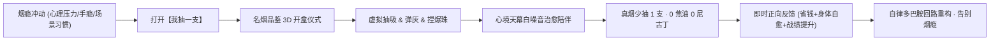
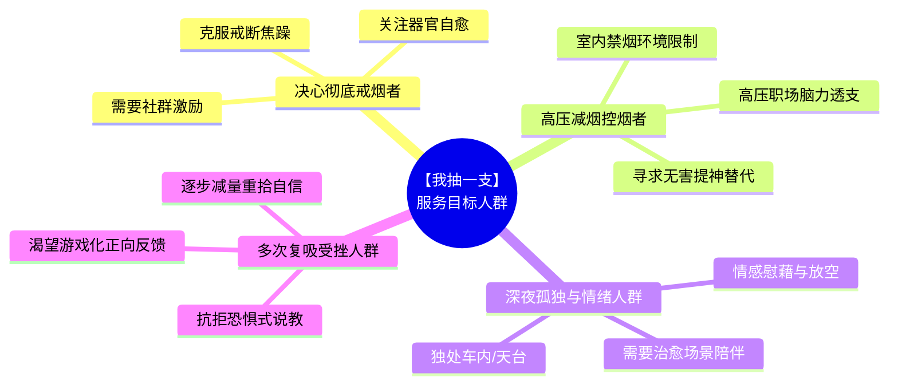

# 【我抽一支】(Just One Smoke) · 科学控烟与赛博拟真解压系统

> **新一代行为替代心理疗愈小程序 · 纯血零后端高保真离线架构 · 践行《健康中国2030》控烟减害倡导**

---

## 目录 (Table of Contents)
- [一、 项目核心定位 (Core Positioning)](#一-项目核心定位-core-positioning)
- [二、 服务目标人群画像 (Target Audience)](#二-服务目标人群画像-target-audience)
- [三、 全系统页面定位与价值创造矩阵 (Pages & Value Matrix)](#三-全系统页面定位与价值创造矩阵-pages--value-matrix)
  - [1. 首页 · 沉浸模拟抽吸舞台 (`pages/index/index`)](#1-首页--沉浸模拟抽吸舞台-pagesindexindex)
  - [2. 传世典藏 · 烟盒典藏馆 (`pages/shop/shop`)](#2-传世典藏--烟盒典藏馆-pagesshopshop)
  - [3. 名烟品鉴 · 3D拟真开盒 (`pages/pack/pack`)](#3-名烟品鉴--3d拟真开盒-pagespackpack)
  - [4. 巅峰天梯 · 自律排行榜 (`pages/leaderboard/leaderboard`)](#4-巅峰天梯--自律排行榜-pagesleaderboardleaderboard)
  - [5. 机能蜕变 · 健康数字孪生 (`pages/mine/mine`)](#5-机能蜕变--健康数字孪生-pagesminemine)
  - [6. 尊享会员中心 (`pages/vip/vip`)](#6-尊享会员中心-pagesvipvip)
- [四、 视听触多模态动力学引擎体系 (Sensory & Engine Architecture)](#四-视听触多模态动力学引擎体系-sensory--engine-architecture)
- [五、 法律法规与社会公益合规承诺 (Legal Compliance & Ethics)](#五-法律法规与社会公益合规承诺-legal-compliance--ethics)
- [六、 开发者快速启动与协作铁律 (Quickstart & AI Guidelines)](#六-开发者快速启动与协作铁律-quickstart--ai-guidelines)

---

## 一、 项目核心定位 (Core Positioning)

传统戒烟应用往往充斥着生硬的枯燥倒计时、令人恐慌厌恶的病理烂肺图片以及居高临下的道德说教，这种**“恐惧驱使型设计”**往往让受挫烟民产生逃避与心理逆反，最终导致放弃与复吸。

**【我抽一支】** 打破了这种固有模式，确立了截然不同的产品定位：

### 🎯 核心定位：
> **「以赛博拟真交互为载体、以心境陪伴与触感通感为慰藉、以科学正向反馈为驱动的 —— 新一代情绪减压与科学控烟健康生活小程序」**



### 💎 产品核心哲学：
1. **替代而非强行压抑**：抽烟不仅是化学尼古丁依赖，更是长年累月的“手部动作习惯、呼吸节奏调节、精神放空逃避与开盒点火仪式感”。通过 100% 还原这一套动作，**以 0 焦油、0 尼古丁的赛博交互欺骗大脑多巴胺回路**，实现温柔平替。
2. **正向激励而非恐惧恐吓**：少抽一支烟，屏幕上实时弹出“省下 ¥2.50、免吸焦油 10mg、心肺自愈步进”的即时奖赏，把每一次意志克制转化为肉眼可见的数字财富。
3. **情绪避风港而非冰冷工具**：提供雨夜车窗、温馨小家、暖阁喵眠、雨夜龙猫、星港巨舰、星链天网等 16 款精选沉浸场景，让每一个疲惫孤独的灵魂在想抽烟的瞬间，得到一个温暖且不伤身体的情感归宿。

---

## 二、 服务目标人群画像 (Target Audience)

本项目深度契合现代烟民在不同心理阶段与现实生活场景中的诉求，精准服务四大核心客群：



### 1. 决心彻底戒烟的攻坚者（戒烟起步期 1~90 天人群）
- **核心痛点**：戒烟初期伴随强烈的戒断综合征，手痒、嘴巴空虚、无所适从、情绪易怒焦躁，极易在无聊时复吸。
- **服务价值**：提供随时拿在手里的“虚拟香烟”，想抽随时抽一支，平稳过渡生理与心理断瘾期；通过四大器官医学级数字孪生体，清晰看到心血管、肺部血氧每天自愈进度，增强坚持信心。

### 2. 职场高压与商务控烟人群（无法抽烟或渴望减量人群）
- **核心痛点**：频繁加班、烧脑会议、高铁飞机出行、封闭禁烟办公楼、家中有孕妇婴儿，想吸烟却受到环境与社会规则严厉限制；身体已出现晨起咽喉干呕等亚健康信号，深知真烟危害。
- **服务价值**：提供“随时随地无烟抽吸”的合法合规安全体验，在办公室桌面、会议间隙快速模拟抽一支，瞬间缓解脑力疲劳与焦虑，做到“真烟零消耗，压力零残留”。

### 3. 深夜独处与情绪抚平人群（都市“emo”青年与中年独行者）
- **核心痛点**：下班后坐在车里迟迟不愿上楼、天台吹风面对万家灯火、面对生活压力无处倾诉，抽烟纯粹是为了“借着一呼一吸的时间逃避现实、喘一口气”。
- **服务价值**：营造沉浸式精神避难所。打开「雨夜车窗」、「温馨小家（小熊一家三口）」或「暖阁喵眠」，听着逼真的车外夜雨沙沙声与壁炉柴火噼啪声，看着窗外雪花与熟睡的小猫小熊，获得温柔纯净的深层治愈。

### 4. 尝试戒烟多次失败的受挫者（信心匮乏人群）
- **核心痛点**：曾多次靠意志力硬戒，但只要遇到挫折或社交递烟便瞬间功亏一篑，内心充满自我挫败感，害怕面对冰冷的戒烟失败惩罚。
- **服务价值**：不强调非黑即白的“绝对戒绝”，倡导“只要用它少抽了一支，就是一次伟大的胜利”。通过打卡游戏化、烟盒收集图鉴、称号境界晋级，让用户在快乐收集与成长中自发降低抽烟频率。

---

## 三、 全系统页面定位与价值创造矩阵 (Pages & Value Matrix)

| 页面名称 | 路径 (Route) | 页面定位 | 核心交互与功能 | 为用户创造的核心价值 |
| :--- | :--- | :--- | :--- | :--- |
| **首页 · 模拟舞台** | `pages/index/index` | **核心交互舞台**<br/>即时替瘾避风港 | 触控吸吐、动态红热燃烧、自重弹灰、爆珠捏破、16款沉浸声景环境、7rpx高奢递烟进度环 | **【生理与心理双重解渴】**<br/>0焦油0尼古丁化解当下抽烟冲动；16款治愈场景抚平孤独焦虑；真烟少抽一支，身体减负一分。 |
| **传世典藏 · 烟盒典藏馆** | `pages/shop/shop` | **数字资产展厅**<br/>趣味自律激励馆 | 37款3D微缩名筑与经典烟盒立面陈列（含全新奇趣名筑系列）、少抽支数积累解锁、VIP全图鉴直通 | **【审美收藏与通关动力】**<br/>将枯燥的控烟转化为目标明确的“收集解锁游戏”，满足文化与包装艺术审美，赋予持久自律源动力。 |
| **名烟品鉴 · 3D拟真开盒** | `pages/pack/pack` | **仪式感交互中心**<br/>开包单支取烟仪式 | 3D翻盖开盒、撕金箔封纸、单支香烟微距弹出、香况与焦油量指标透视、60FPS流畅采样、地标专属典藏水印 | **【唤醒仪式感，完成心理锚定】**<br/>还原最享受的抽烟前置开盒仪式，建立“我已经准备好抽一支了”的深层心理暗示，无缝衔接主页点燃。 |
| **巅峰天梯 · 自律排行榜** | `pages/leaderboard/leaderboard` | **全国同行社群**<br/>自律荣耀激励榜 | 少抽榜、省钱榜、坚持榜、人气榜四大白话榜单，击败全国战绩，每日点赞送心 | **【归属感与荣誉自豪】**<br/>告别孤独作战，感受全国数十万烟民共同抗瘾的群体力量；点赞互勉温情流动，让每一次克制都被看见。 |
| **机能蜕变 · 健康数字孪生** | `pages/mine/mine` | **个人健康账本**<br/>机能自愈数字孪生 | 人体四大生理系统全息医学扫描、25款全域流光换肤轻量装扮中心、焦油减免量测算、省下烟钱统计、自律历史日志 | **【健康量化与医学可视化】**<br/>将看不见的健康转化为真金白银与机能自愈图谱，亲眼目睹身体器官每一天的净白新生，重塑自爱。 |
| **尊享会员中心** | `pages/vip/vip` | **VIP特权殿堂**<br/>高奢声光体验专区 | 25款全系流光心境色彩、10款赛博与东方神品烟雾粒子、全套37款烟盒全畅享、永久抽屉库存、荣耀金冠铭牌 | **【体验跃迁与尊荣激励】**<br/>享受无限制的高清音画艺术，尊贵身份外显激励自律；透明清爽增值服务保障产品长远纯净无广告运营。 |

---

### 详细页面拆解与价值深度剖析：

#### 1. 首页 · 沉浸模拟抽吸舞台 (`pages/index/index`)
- **页面定位**：全应用第一核心主舞台，承担“烟瘾来袭时的第一道防火墙”。
- **核心交互亮点**：
  - **触觉通感**：长按屏幕启动吸气，模拟真实烟气负压吸入感；松手触发舒缓呼气，烟雾升腾；
  - **物理光学拟真**：烟头红热发光强度（Embers）随吸烟时长动态增强，并向四周环境投射漫反射光斑；烟灰依物理燃烧公式累积变长，支持手指轻弹或达到重力临界点时自然断裂飘散；
  - **世界名筑系列专属拟真力学**：
    - **埃菲尔铁塔**：整根烟即铁塔本体，烟嘴为底部双曲镂空拱门与外展基座，上面为中上段钢构塔身与避雷针尖尖，火头自塔尖向底座逐级向下燃烧；燃烧烟灰宽度严格自适应高程几何截面（尖顶 4px 细烟灰至底座 30px 平滑过渡），彻底杜绝机制粗灰失真；
    - **比萨斜塔**：罗马柱廊回廊雕塑外观，整根烟自倾 3.99°（斜而不倒），大理石盲拱底座；
    - **吉萨金字塔**：四千年尼罗河玄武岩巨石基座、巨石阶梯与荷鲁斯全知曜金之眼；
    - **东方明珠**：魔都天际双球太空舱与发射天线针尖，支持草莓薄荷双爆珠微距捏破；
  - **爆珠微距交互**：手指微距精准点击过滤嘴上的爆珠图案，伴随清脆爆破音效与触觉震动脉冲，爆珠破裂并点亮果味薄荷流光光晕；
  - **高精度 Dock 交互规范**：外围进度环采用标准 7rpx 视觉规格（「递烟」与「抖灰」进度环完全对称），兼具灵动微光与精准刻度；
  - **4-7-8 静心吐纳 (19秒黄金正念)**：4s慢吸 ➔ 7s静屏 ➔ 8s深呼，解耦中心字层，1.18 黄金呼吸比留白宽裕，字与圈界限分明，平复交感神经，消除心瘾焦躁；
  - **桌面微距沉淀烟灰缸 (100支大容量)**：物理沉淀上限扩容至 100 支烟蒂（整整 5 包容量）+ 100 处炭灰微粒，以 20 支整盒为评价阶梯，忠实记录生活足迹，支持随时一键清爽倾倒；
  - **跨天配额无感静默送达**：彻底剔除阻断性提示弹窗与横幅，每日 1 包未拆新盒在后台静默自动充入桌边抽屉资产中，用户打开抽屉随时可拆，零打扰、高获得感。
- **创造的核心价值**：在用户产生“想抽一支真烟”念头的黄金 5 秒内，提供触手可得的无害代偿，真正做到“想抽就抽，抽完就放，无伤解瘾”。

#### 2. 传世典藏 · 烟盒典藏馆 (`pages/shop/shop`)
- **页面定位**：将戒烟从“苦行僧式的戒断”转变为“满载成就感的收集游戏”。
- **核心交互亮点**：
  - 收录 37 款覆盖传统国风、经典烤烟、古巴高希霸雪茄以及全新「名筑」世界建筑系列的 3D 精致烟盒；
  - **六大精炼分类**：全部、名筑、经典、国烤、细支、港外，一键直达心仪风格；
  - **严格合规警示专区**：全系烟盒立面图片均严格印制标准“本公司提示 / 吸烟有害健康 / 请勿在禁烟场所吸烟 / 劝阻青少年吸烟 · 禁止中小学生吸烟”四级权威警示，恪守控烟伦理与微信生态合规；
  - 采用独特的**「自律打卡解锁进度链」**：埃菲尔铁塔默认 0 支解锁即开即用，后续名筑阶梯式解锁，已达成支数以绿色能量进度条动态呈现；
  - 支持 VIP 会员尊享直通特权，一键解锁全系列图鉴。
- **创造的核心价值**：彻底消除实体烟草非法销售的合规隐患，以数字文化收藏赋能健康生活；给用户设定阶梯式目标，让每一次自律都富有期待感。

#### 3. 名烟品鉴 · 3D拟真开盒 (`pages/pack/pack`)
- **页面定位**：专注于打造高端沉浸式“开包取烟前置仪式感”。
- **核心交互亮点**：
  - 纯原生 Canvas 2D / 3D 透视矩阵，支持手指拖拽 360° 翻转检视烟盒包装细节；
  - 点击盒盖触发丝滑的翻盖阻尼动画与清脆铰链开合音效；
  - 撕开盒内防潮银锡封纸，内置香烟整齐排布，轻触弹出一支特写香烟；
  - 经过 60FPS 极速渲染与零垃圾回收（Zero-Allocation）调优，剔除高能耗高斯模糊滤镜，流畅输出开盒光束与香烟升腾动效；
  - 提供单支“我抽一支”直接点燃通道，烟支自带物理滤嘴（中空滤棒、同心圆、螺旋纸筒等工艺细节）。
- **创造的核心价值**：老烟民抽烟往往有 50% 的快感来源于“撕开包装、敲烟弹出一支”的手部仪式。本页面完整保留了这种经典质感，让用户在享受仪式感的同时，免受真烟毒害。

#### 4. 巅峰天梯 · 自律排行榜 (`pages/leaderboard/leaderboard`)
- **页面定位**：全国同行者的自律竞技场与温情互助社区。
- **核心交互亮点**：
  - **四大通俗易懂分榜**：
    - `🌿 少抽榜`：比拼累计少抽真烟支数；
    - `💰 省钱榜`：以国家中高档烟基准（¥2.5/支）统算，防作弊公正排行；
    - `⏳ 坚持榜`：比拼持续自律不抽真烟的连续天数；
    - `❤️ 人气榜`：比拼全国同修烟友赠送的点赞爱心总数。
  - **英雄榜单卡片**：展示 No.1~No.50 全国榜首与用户当前排位、战胜全国百分比、专属 16 阶成语境界称号铭牌（从“初入禅境”到“无烟圣尊”）；
  - **温情送心**：每日可为榜单同行者赠送爱心与鼓励。
- **创造的核心价值**：打破戒烟的孤独壁垒。在社会心理学中，群体认同是最强大的自律支撑力，排行榜让用户深知“全国有成千上万的朋友正与我并肩作战”，每一次克制都是登顶荣耀的基石。

#### 5. 机能蜕变 · 健康数字孪生 (`pages/mine/mine`)
- **页面定位**：用户的全维度健康资产大本营与终身自律档案。
- **核心交互亮点**：
  - **机能透视 · 数字孪生人体**：3D 全息医学透视扫描人体的四大生理系统：
    1. `呼吸系统`（双肺气道与肺叶）：焦油沉淀减少、肺纤毛摆动自洁、肺活量提升；
    2. `心血管系统`（心脏与冠状动脉）：心率平缓、血压回稳、心肌梗死风险断崖式下降；
    3. `微循环系统`（纯净血滴与毛细血管）：一氧化碳排空、血液携氧量恢复正常、手脚回暖；
    4. `自律神经系统`（脑波舒缓波纹）：焦虑感褪去、睡眠深沉度显著回升。
  - **直观真金白银收益**：以人民币现金大字呈现累计节省烟资，直观感受“少抽烟真的能省出一台电脑、一趟旅游”；
  - **全域流光心境装扮中心（内嵌轻量折叠卡片）**：
    - 25 款高奢自然流光色彩覆盖全站所有页面，划分为「经典原色」、「灵动光影」、「幽山深境」三大风格；
    - **双轨制成长与永久记忆**：VIP 会员尊享 0 门槛免等待全系直通，普通用户通过自律天数（1~60天）或累计替烟支数（5~300支）亦能 100% 免费逐一解锁全部色彩，践行“花时间即可获得一切”的产品哲学；
    - **沉浸式试换预览**：支持微距色块即时光影预览与倒计时天数提示，离开页面自动复位，杜绝非授权篡改；支持最后选择色彩与分类的本地持久化同步；
  - **个人专属设置**：支持自定义真实日常烟价（如 30元/包、80元/包），让账目分毫不差；提供自律日历热力图与历史打卡足迹。
- **创造的核心价值**：真烟对身体的损伤是潜移默化的，戒烟带来的身体恢复同样是肉眼难辨的。本页面通过精密科学数学模型，把身体内部每一天的“新生奇迹”画给用户看，提供无与伦比的情绪价值与健康掌控感。

#### 6. 尊享会员中心 (`pages/vip/vip`)
- **页面定位**：VIP 尊崇特权殿堂，保障高品质运营的阳光商业闭环。
- **核心交互亮点**：
  - **6 大尊享核心特权**：0 秒免看激励广告直通、25 款全系流光心境色彩即刻直通、10 款赛博与东方神品烟雾特效任意选、全套 37 款烟盒收藏全畅享、永久抽屉库存、荣耀金冠流光铭牌；
  - **清爽定价套餐**：终身永久断买、月度、年度清晰透明方案；
  - **合规保护设计**：针对 iOS 严格遵循平台规范，提供纯净公益免费点亮通道；全流程零虚假宣传。
- **创造的核心价值**：为追求极致视听审美的自律伙伴提供无拘无束的定制化体验，同时为小程序长期免广告骚扰、持续高规格升级奠定健康的商业生命力。

---

## 四、 视听触多模态动力学引擎体系 (Sensory & Engine Architecture)

为了实现腾讯大厂级的产品体验，项目底层自研了完整的多模态动力学引擎：

```
+--------------------------------------------------------------------------+
|                     【我抽一支】 多模态交互感知系统                      |
+--------------------------------------------------------------------------+
|  视觉层 (Visual)       |  纯原生 Canvas 2D 硬件加速燃烧与光学投影         |
|                        |  自研 60FPS 赛博粒子涡流烟雾引擎 (particleSystem)|
|                        |  微距 3D 拟真翻盖铰链开盒透视矩阵                |
+------------------------+-------------------------------------------------+
|  听觉层 (Auditory)     |  WebAudio API 实时纯程序音频合成技术            |
|                        |  18 种空间立体声心境白噪音 (雨夜、车库、篝火等)   |
|                        |  528Hz 修复级正弦自然和弦 + 禅意铜磬解压频度     |
+------------------------+-------------------------------------------------+
|  触觉层 (Haptic)       |  自研阶梯式触觉微震脉冲引擎 (hapticsEngine)       |
|                        |  真实负压微震、爆珠破裂双脉冲、弹灰脆震、点火爆燃 |
+------------------------+-------------------------------------------------+
|  存储层 (Persistence)  |  全本地高可靠持久化闭环 (storageService)          |
|                        |  100% 离线可用，零外部网络依赖，绝对守护隐私     |
+--------------------------------------------------------------------------+
```

---

## 五、 法律法规与社会公益合规承诺 (Legal Compliance & Ethics)

本项目在产品设计之初，便将**国家法律法规与未成年人保护**确立为不可逾越的红线：

1. **严格遵守《中华人民共和国广告法》第二十二条**：
   - 严禁发布任何烟草制品广告；
   - 严禁以“名烟评测、品鉴推荐、香烟代购”等变相手段诱导吸烟；
   - 本项目全面采用“烟盒收藏馆”、“3D拟真开盒”等中性技术描述，核心立足点为心理学替代与自律控烟。
2. **严格遵守《中华人民共和国烟草专卖法》及其实施条例**：
   - 严禁通过信息网络销售烟草专卖品；
   - 本项目无任何实物烟草买卖、无任何电商交易跳转链接、无任何烟草招商行为，所有烟盒与烟支均为纯虚拟 3D 数字化代码。
3. **严格遵守《微信小程序平台运营规范》**：
   - 类目定位于“生活健康 / 效率工具”，不涉及管制类商品营销；
   - 页面文案彻底告别“老烟枪”、“替烟产品（易混淆电子烟）”等词汇，全面采用“少抽、控烟、健康、自律”等官方认可的正能量健康倡导词汇。
4. **纯前端离线隐私保护**：
   - 用户的抽烟打卡记录、烟资开销、戒烟天数等敏感数据**100% 存储于手机本地微信 Storage 中**，不上传任何第三方云服务器，杜绝个人健康隐私泄露。

---

## 六、 开发者快速启动与协作铁律 (Quickstart & AI Guidelines)

### 1. 本地导入与调试
1. 下载并安装最新版 [微信开发者工具](https://developers.weixin.qq.com/miniprogram/dev/devtools/download.html)。
2. 启动开发者工具，选择 **导入项目**。
3. **代码目录**：选择本项目根目录 `just-one-smoke`。
4. **AppID**：填入您的测试号或正式小程序 AppID。
5. 点击确认即可完成加载，支持全屏预览与真机扫码调试。

### 2. 🚨 Git 版本控制绝对铁律 (Strict Git Safety Rules)
根据项目工程规范：
- **严禁 AI 自动执行 `git commit` 与 `git push`**：任何场景、任何阶段，AI 编程助手绝对禁止擅自提交或推送代码；
- **提交与推送权限归属**：必须且只能由**开发者本人**亲自在终端审查 Diff 后手动执行提交与推送；
- **只读白名单**：AI 助手仅被允许执行 `git status`、`git diff`、`git log` 等安全只读查询。

### 3. 🚫 零测试脚本原则
- 严禁在工程中创建任何临时测试用例或测试报告（如 `test_*.js`、`*.test.js`、`scripts/verify_*.js` 等），避免产生冗余 Token 与体积膨胀；依靠严谨的直接代码审查保障运行质量。

---

## 📄 开源许可证
本项目遵循 [MIT 许可证](LICENSE) 授权许可。
倡导纯净自律，愿每一次深呼吸都如森林晨曦般清澈。
